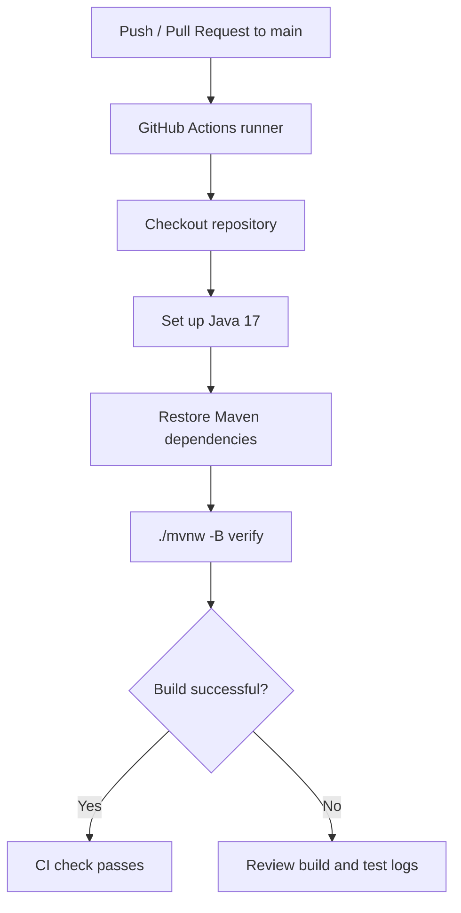

# Spring PetClinic — Java CI Learning Project

[](https://github.com/mavanirahul1996/spring-petclinic-rahul/actions/workflows/maven-build.yml)

A personal DevOps learning repository based on the Spring PetClinic sample application. The focus of this repository is building and verifying a Java application with **Maven and GitHub Actions**, while practising local database services with Docker Compose.

> This repository is a learning copy of the upstream [Spring PetClinic project](https://github.com/spring-projects/spring-petclinic). The original application documentation and licence remain applicable.

## Project overview

| Area | Technology |
|---|---|
| Application | Spring Boot, Java |
| Build tool | Maven Wrapper |
| CI | GitHub Actions |
| Databases | H2 by default; MySQL and PostgreSQL profiles |
| Local services | Docker Compose |

## CI pipeline

The workflow at [`.github/workflows/maven-build.yml`](.github/workflows/maven-build.yml) runs on pushes and pull requests targeting `main`.



**What the workflow currently does:** checks out the code, configures Java 17 with Maven dependency caching, and runs `./mvnw -B verify`.

**EC2 deployment:** a separate job is available through manual workflow dispatch. It is not run automatically on every push. The previous deployment attempt reached the SSH stage but timed out connecting to the configured EC2 host on port 22. Confirm the EC2 instance is running, the host secret is current, and its security group allows SSH from the GitHub-hosted runner before selecting `deploy_to_ec2=true`.

**Not included:** container publishing or a SonarQube quality gate.

[View GitHub Actions runs](https://github.com/mavanirahul1996/spring-petclinic-rahul/actions)

## Run locally

### Prerequisites

- Java 17 or newer
- Git
- Docker Desktop or Docker Engine (only needed for the database containers)

Clone your learning repository:

```bash
git clone https://github.com/mavanirahul1996/spring-petclinic-rahul.git
cd spring-petclinic-rahul
```

Start the application with the default configuration:

```bash
./mvnw spring-boot:run
```

Open [http://localhost:8080](http://localhost:8080).

The default application configuration uses an in-memory H2 database.

## Run the database services with Docker Compose

The Compose file defines MySQL and PostgreSQL services for local database practice. Start only the database you want to use:

```bash
# MySQL
docker compose up -d mysql

# Or PostgreSQL
docker compose up -d postgres
```

The PostgreSQL container is mapped to host port `5433` (container port `5432`). MySQL uses host port `3306`.

Activate the matching Spring profile when running the application:

```bash
# MySQL profile
SPRING_PROFILES_ACTIVE=mysql ./mvnw spring-boot:run

# PostgreSQL profile
SPRING_PROFILES_ACTIVE=postgres ./mvnw spring-boot:run
```

The Compose credentials are for local learning only. Do not reuse them in production.

## Build and test

Run the same verification command used by CI:

```bash
./mvnw -B verify
```

Build a container image using the Spring Boot Maven plugin:

```bash
./mvnw spring-boot:build-image
```

## Repository focus

This project is useful for practising:

- Java and Spring Boot application structure.
- Maven builds and the Maven Wrapper.
- Automated verification with GitHub Actions.
- Database profiles and local MySQL/PostgreSQL services.
- Reading CI logs and troubleshooting failed builds.

## Next improvements

- Add a verified container publish workflow.
- Add a deployment stage only after the target environment and secure authentication are configured.
- Add a SonarQube analysis and quality gate.
- Add deployment health checks and rollback documentation.

---

**Upstream project:** [spring-projects/spring-petclinic](https://github.com/spring-projects/spring-petclinic). This repository should be understood as a personal learning and CI configuration exercise, not as the original Spring PetClinic project.


## Manual EC2 deployment

After confirming EC2 network access and the `EC2_HOST` and `EC2_PRIVATE_KEY` repository secrets, open **Actions → Java CI/CD Pipeline with Maven → Run workflow** and select `deploy_to_ec2=true`. Normal pushes and pull requests run build and test only.
